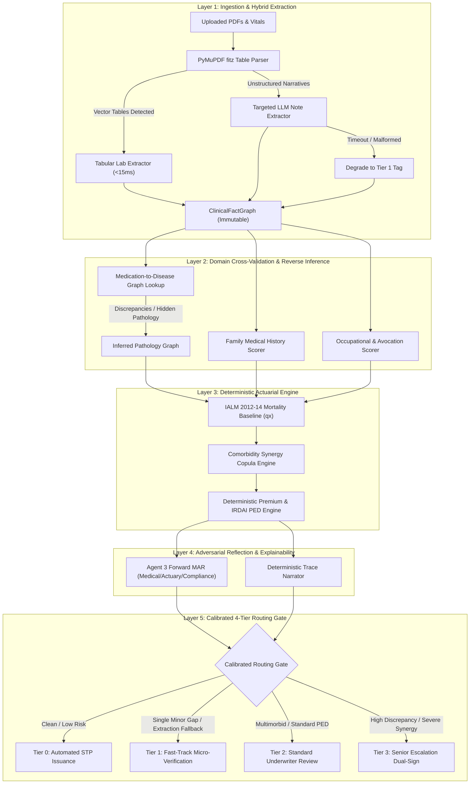

# Enterprise Medical Underwriting Engine Architecture Rework

*   **Author:** B_Karthikeyan
*   **Status:** Draft
*   **Date:** 2026-11-16
*   **Target Repository:** `c:\Capstone_Proj\Med_Underwriter` (branch `v5.2`)

--------------------------------------------------------------------------------

## Overview

This design transforms the **MedUnderwriter** platform from a prototype using linear additive scoring heuristics, rigid regular expression (regex) parsing, and flat pricing into an enterprise-grade medical underwriting engine. The platform automates life and health insurance policy assessment by combining deterministic actuarial calculations with targeted agentic reasoning.

The system evaluates applicant disclosures and medical records, applies actuarial mortality baselines and synergistic multi-morbidity copulas, conducts adversarial multi-persona reflection, and routes cases through a calibrated 4-tier decision gate.

## The Problem

The existing prototype (`v5.2`) suffers from several structural and clinical underwriting limitations:

1. **Linear Additive Fallacy in Medical Risk**:
   The current risk engine adds fixed point debits linearly (`medical_score += weight`). A profile with Type 2 Diabetes ($15$), Hypertension ($8$), and Obesity ($10$) receives $33$ points—resulting in an inadequate 10% premium loading. In clinical actuarial reality, metabolic syndrome exponentially accelerates cardiovascular and renal mortality, requiring non-linear compounding ($+150\%$ to $+200\%$ loading or deferral).
2. **Missing Real-World Underwriting Domains**:
   The system lacks four standard underwriting pillars:
   * **Family Medical History**: Premature death or disease in first-degree relatives before age 60.
   * **Occupational & Avocation Hazards**: Standardized occupational hazard classes (ISCO-08 tiers 1–4) and hazardous recreational activities.
   * **Reverse Pharmacotherapy Inference**: Deducing undisclosed pathology from active prescription records (e.g., Atorvastatin + Clopidogrel indicating ischemic heart disease).
   * **Statutory Waiting Periods & Exclusions**: IRDAI 2024 compliance capping Pre-Existing Disease (PED) waiting periods at 36 months and applying specific ailment exclusion riders.
3. **Flat Pricing Baseline**:
   Premiums are calculated using a static 3% base rate ($\text{Sum Insured} \times 0.03 \times \text{Years}$), ignoring standard age-and-gender mortality curves ($q_x$).
4. **Extraction Fragility**:
   PyMuPDF extraction with 40-character regex negation windows fails on multi-column diagnostic tables and misinterprets complex clinical syntax (e.g., family history or discontinued habits).
5. **Review Queue Choking & Post-Hoc Rationalization**:
   A rigid confidence threshold ($< 0.70$) forces 50–70% of routine cases into manual review, while LLM reflection personas frequently construct post-hoc justifications for flawed deterministic scores.

---

## Goals

*   **G1: Actuarial Baseline Pricing**: Embed a full single-year biological age lookup table (ages 18–75 for males and females) referencing Indian Assured Lives Mortality (IALM 2012–14 Ultimate) rates ($q_x$).
*   **G2: Multiplicative Comorbidity Synergy**: Implement an actuarial copula engine modeling synergistic mortality risk for metabolic syndrome, cardiorenal syndrome, and respiratory multimorbidity.
*   **G3: Domain Completeness**: Integrate data models and scoring for Family Medical History, Occupational Hazards (ISCO-08), Context-Aware Reverse Pharmacotherapy Inference, and IRDAI 2024 PED Waiting Periods (36-month cap).
*   **G4: Resilient Hybrid Extraction**: Implement PyMuPDF table detection (`page.find_tables()`) for structured lab panels with targeted JSON-schema LLM fallback for unstructured notes, degrading gracefully to Tier 1 review on timeout.
*   **G5: Calibrated 4-Tier Routing**: Achieve $\ge 40\%$ automated Straight-Through Processing (STP) on clean lives while escalating complex risks to targeted micro-verification, standard review, or senior dual-signoff.
*   **G6: Forward Adversarial Reflection**: Reconfigure Agent 3 personas (Actuary, CMO, Compliance) to conduct independent guideline falsification tests against source clinical facts without modifying mathematical scores.

---

## Non-Goals

*   **NG1: Heavy Local Vision OCR**: Deploying multi-gigabyte local vision models (LayoutLM, Donut); all document processing relies on PyMuPDF and lightweight API/distilled LLM text fallback.
*   **NG2: Live Hospital EHR/FHIR Integration**: Real-time integration with live hospital APIs; input remains standardized PDF documents and intake payloads.
*   **NG3: Billing & Policy Administration Integration**: Payment gateway processing, premium collection, or policy number dispatch within external Core PAS systems.

---

## Open Questions

*   **Question 1**: Should the IALM 2012–14 mortality table rates be stored as an in-memory Python dictionary or as a SQLite reference table with indexed lookups?
*   **Question 2**: For female applicants prescribed Metformin without declared diabetes or PCOS, should the system prompt for a mandatory intake clarification before initiating pipeline evaluation?

---

## Critical User Journeys (CUJs)

### CUJ 1: Clean Standard Applicant (Automated Straight-Through Processing - Tier 0)

*   **Given**: A 28-year-old software engineer (Occupation Class 1) applying for INR 1,000,000 cover with clean self-declarations, normal BMI ($22.4$), and normal uploaded lab reports (CBC, HbA1c $5.2\%$, Lipids normal).
*   **When**: The application is submitted through the intake portal.
*   **Then**:
    * PyMuPDF parses the lab table deterministically in $<15\text{ms}$.
    * Actuarial baseline assigns age 28 mortality rate $q_{28}$.
    * Comorbidity debits $= 0$; loading $= 0\%$.
    * Agent 3 passes consensus; review gate routes to **Tier 0 (Straight-Through Processing)**.
    * Final policy schedule is issued automatically in under 5 seconds.

### CUJ 2: Multi-Morbid Applicant (Copula Synergistic Loading & Waiting Period - Tier 2)

*   **Given**: A 52-year-old male with declared Type 2 Diabetes, Hypertension, and BMI $32.1$ (Obese). Uploaded lab report shows HbA1c $8.2\%$ and Serum Creatinine $1.1\text{ mg/dL}$.
*   **When**: The application pipeline runs.
*   **Then**:
    * Individual condition debits are compiled: $\text{T2D} = 50$, $\text{HTN} = 25$, $\text{Obesity} = 20$.
    * The Comorbidity Copula detects Metabolic Syndrome Triad and applies the synergistic interaction multiplier $\gamma_{\text{metabolic}} = 1.45$, calculating $137.75$ debits (vs $95$ additive).
    * Actuarial pricing computes loaded premium ($+150\%$) and attaches a statutory 36-month PED waiting period schedule for diabetic/hypertensive complications.
    * Routed to **Tier 2 (Standard Underwriter Review)** with pre-populated actuarial waterfall breakdown.

### CUJ 3: Prescription Discrepancy & Reverse Pharmacotherapy Triage (Tier 1 Fast-Track)

*   **Given**: An applicant declares no chronic diseases, but uploaded medical bills list *Metformin 500mg OD*.
*   **When**: The extraction and cross-validation stage executes.
*   **Then**:
    * Reverse inference identifies Metformin as a multi-indication medication (`requires_context`).
    * The engine avoids triggering a severe fraud alert; instead, it raises a discrepancy flag with low weight and routes to **Tier 1 (Fast-Track Micro-Verification)**.
    * The underwriter receives a 1-click verification prompt: *"Confirm indication: PCOS, pre-diabetes, or undisclosed T2D?"*.

### CUJ 4: Critical Undisclosed Pathology (Tier 3 Senior Medical Escalation)

*   **Given**: An applicant declares clean health, but an uploaded discharge summary contains *Atorvastatin 40mg + Clopidogrel 75mg* and mentions *acute coronary syndrome*.
*   **When**: Agent 1 and the discrepancy engine process the document.
*   **Then**:
    * Reverse inference flags unambiguous critical cardiovascular pharmacotherapy (`REVERSE_INFERRED_CRITICAL_PATHOLOGY`).
    * Discrepancy score jumps to $65$ (above the 60 threshold).
    * The case is routed directly to **Tier 3 (Senior Escalation)** requiring dual-signature authorization (Senior Underwriter + Chief Medical Officer) with decline or heavy rated terms recommended.


--------------------------------------------------------------------------------

## Technical Plan (Architecture)

### 1. High-Level Architectural Layers

The architecture enforces strict separation between stochastic language model operations and deterministic actuarial rating:



---

### 2. Component Design & System Boundaries

#### Layer 1: Ingestion & Hybrid Extraction (`backend/app/rag/structured.py`)
*   **PyMuPDF (`fitz`) Table Grid Parser**: Scans document pages with `page.find_tables()`. When borders or column alignments are detected, structured rows (`test_name`, `observed_value`, `unit`, `ref_interval`, `flag`) are parsed directly into typed records in $<15\text{ms}$ with zero LLM API calls.
*   **Targeted LLM Fallback**: Non-tabular free-text pages (e.g., discharge summaries, clinical history) are passed to a JSON-mode LLM call using strict schema constraints.
*   **Resilient Fallback Policy**: If the LLM call times out ($>10\text{s}$) or emits invalid JSON, the engine does not crash or retry indefinitely. It logs `fallback_reason: "LLM extraction timeout on page X"`, extracts regex keywords as an advisory baseline, and flags the case for **Tier 1 Fast-Track** review with the page highlighted.

#### Layer 2: Domain Cross-Validation & Reverse Inference (`backend/app/services/reverse_pharmacotherapy.py`)
*   **Medication Inference Knowledge Graph (`backend/app/data/medication_inference_map.json`)**:
    *   *Unambiguous Single-Indication Drugs*: E.g., `Insulin`, `Glimepiride` $\rightarrow$ `Type 2 Diabetes` (ICD-10: E11); `Clopidogrel`, `Ticagrelor` $\rightarrow$ `Ischemic Heart Disease` (ICD-10: I25); `Methotrexate` $\rightarrow$ `Autoimmune / Rheumatoid Disease` (ICD-10: M06).
    *   *Multi-Indication Drugs (`requires_context`)*: E.g., `Metformin` $\rightarrow$ mapped to `PCOS / Pre-Diabetes / T2D`. The engine checks applicant sex and declared conditions. If PCOS is declared, Metformin is validated as consistent without fraud penalties. If no condition is declared, it generates a low-weight micro-task for Tier 1 review rather than triggering a high-discrepancy fraud alert.

#### Layer 3: Deterministic Actuarial Engine (`backend/app/services/medical_synergy.py`)
*   **Actuarial Baseline Mortality ($q_x$)**: Replaces flat 3% pricing with exact Indian Assured Lives Mortality (IALM 2012–14 Ultimate) tables embedded as a single-year biological age lookup table (ages 18–75, male/female).
*   **The Numerical Rating System (Debits & Credits)**:
    $$\text{Extra Mortality Percentage } (EM) = \text{Base}(100) + \sum_{i=1}^n D_i \times \Phi(\mathbf{C}) + \sum \Delta_{\text{synergy}} - \text{Credits}$$
    Where $D_i$ represents individual condition debits, and $\Phi(\mathbf{C})$ represents the non-linear comorbidity copula interaction factor:
    *   **Metabolic Syndrome Triad** ($\text{T2D} + \text{HTN} + \text{BMI} \ge 30$): $\Phi_{\text{metabolic}} = 1.45$.
        $$\text{Debit} = (50 + 25 + 20) \times 1.45 = 137.75 \text{ debits (vs } 95 \text{ additive)}$$
    *   **Cardiorenal Syndrome** ($\text{CAD/Heart Failure} + \text{CKD}$): $\Phi_{\text{cardiorenal}} = 2.10$ (escalates immediately to Tier 3 senior review).
    *   **Respiratory Multimorbidity** ($\text{COPD} + \text{Asthma} + \text{Smoker}$): $\Phi_{\text{respiratory}} = 1.75$.
*   **IRDAI 2024 PED Waiting Period & Exclusion Schedules**:
    *   Caps maximum statutory waiting period at 36 continuous months.
    *   Generates specific ailment 24-month waiting periods for declared elective surgical conditions (Cataract, Hernia, Joint Replacement).

#### Layer 4: Adversarial Reflection & Explainability (`backend/app/agents/agent3_reflection.py`)
*   **Anti-Rationalization Protocol**: Personas (Chief Medical Officer, Actuary, Compliance Officer) do not receive pre-generated justifications. Instead, they receive:
    1. Immutable extracted clinical facts and lab values.
    2. Applied deterministic debits and copula factors.
    3. Proposed pricing and exclusion schedule.
*   Personas execute an **adversarial falsification test**: *"Given standard clinical practice guidelines (ADA, ACC/AHA) and statutory underwriting regulations, identify any omissions, contraindications, or severe risks uncaptured by this proposal."*
*   Personas cannot directly alter numerical scores; any material concern emits an `advisory_finding` that deterministically adjusts the case's review tier.

#### Layer 5: Calibrated 4-Tier Routing Gate (`backend/app/services/review_gate.py`)
*   **Tier 0: Automated Straight-Through Processing (STP)**: Zero undeclared conditions, overall risk score $< 40$, loading $\le 10\%$, evidence completeness $\ge 0.90$.
*   **Tier 1: Fast-Track Micro-Verification**: Single isolated routine condition, extraction fallback/timeout tag, or multi-indication drug context check. Underwriter UI presents a single 1-click confirmation diff ($< 2$ minute resolution).
*   **Tier 2: Standard Underwriter Review**: Moderate multimorbidity (loading 25%–75%), lab values in borderline ranges, or customized PED exclusion schedules.
*   **Tier 3: Senior Escalation / CMO Dual-Sign**: Severe pathology (reverse-inferred CAD, cancer, CKD), severe copula synergy ($EM > 150\%$), discrepancy score $\ge 60$, or Sum Insured $\ge \text{INR } 2,500,000$ with high clinical complexity.

---

### 3. Core Data Schemas (Pydantic v2 Models)

```python
class FamilyMemberRelation(str, Enum):
    FATHER = "father"
    MOTHER = "mother"
    SIBLING = "sibling"

class FamilyHistoryRecord(BaseModel):
    relation: FamilyMemberRelation
    condition_code: str  # e.g., "cad_premature", "diabetes_t2", "colorectal_cancer"
    age_at_onset: int
    deceased: bool = False
    age_at_death: int | None = None

class OccupationHazardClass(int, Enum):
    CLASS_1_DESK = 1
    CLASS_2_SUPERVISORY = 2
    CLASS_3_MANUAL = 3
    CLASS_4_HAZARDOUS = 4

class OccupationHazardRecord(BaseModel):
    occupation_title: str
    hazard_class: OccupationHazardClass
    loading_per_mille: float = 0.0
    accidental_death_exclusion: bool = False

class MedicationVerificationItem(BaseModel):
    brand_or_generic_name: str
    dosage: str | None = None
    inferred_conditions: list[str]
    context_required: bool = False
    discrepancy_flag: bool = False

class PEDWaitingPeriod(BaseModel):
    condition_code: str
    condition_name: str
    statutory_waiting_months: int  # Max 36 months under IRDAI 2024
    specific_ailment_waiting_months: int = 0
    permanent_exclusion: bool = False
    exclusion_wording: str | None = None

class LabAnalyteRecord(BaseModel):
    analyte_name: str
    loinc_code: str | None = None
    measured_value: float
    canonical_unit: str
    reference_min: float | None = None
    reference_max: float | None = None
    abnormal_flag: bool = False
    source_page: int
```


--------------------------------------------------------------------------------

## Alternatives Considered

### Alternative A: Pure LLM End-to-End Underwriting

*   **Pros**: Rapid development; single model prompt digests raw text and outputs pricing, exclusions, and decisions directly.
*   **Cons**: Stochastic token variation yields inconsistent premiums for identical medical records; lacks reproducible mathematical proofs required by insurance regulators (e.g., IRDAI); high token costs and latency (15–30 seconds per run).
*   **Reason for Rejection**: *Rejected by author*: Insurance underwriting decisions must be actuarially auditable and legally defensible. A non-deterministic model cannot guarantee mathematical consistency across policy renewals or regulatory audits.

### Alternative B: Full Local Vision OCR Pipeline (Tesseract / PaddleOCR / LayoutLM)

*   **Pros**: Capable of reading heavily distorted physical scans, handwriting, and rotated documents.
*   **Cons**: Introduces high CPU/GPU compute requirements, multi-gigabyte model weights, and 30–60 seconds of processing latency per case.
*   **Reason for Rejection**: *Rejected by author*: The prototype's operational scope is focused on digitally generated lab and policy PDFs. PyMuPDF extracts vector text and table grids in $<15\text{ms}$ at near-zero resource cost. Heavy vision models violate the lightweight localhost performance objective.

### Alternative C: Retaining Linear Additive Scoring with Adjusted Risk Thresholds

*   **Pros**: Zero schema changes; requires only tuning point weights in `agent2_risk.py`.
*   **Cons**: Additive scoring treats multi-morbid conditions independently ($15 + 8 + 10 = 33$), failing to capture accelerated microvascular and cardiovascular mortality risk.
*   **Reason for Rejection**: *Rejected by author*: Shifting threshold boundaries cannot fix an invalid mathematical model. Real-world medical underwriting requires multiplicative copulas to price syndromic risk correctly.

### Alternative D: Unchecked Reverse Pharmacotherapy Inference

*   **Pros**: Simple dictionary lookup from drug brand names directly to ICD-10 conditions.
*   **Cons**: Multi-indication medications (e.g., Metformin for PCOS or pre-diabetes; Aspirin for primary prophylaxis) trigger false-alarm fraud investigations on healthy applicants.
*   **Reason for Rejection**: *Rejected by author*: Automatically escalating multi-indication drugs damages straight-through processing rates. Contextual checks (verifying declared PCOS or reproductive history) prevent unwarranted fraud flags.

--------------------------------------------------------------------------------

## Non-Functional Requirements

### 1. Performance & Latency
*   **Tier 0 Straight-Through Processing (STP)**: Target turnaround $< 5\text{ seconds}$ end-to-end on localhost.
*   **PyMuPDF Table Extraction**: Execution runtime $\le 15\text{ms}$ per page on standard diagnostic PDF panels.
*   **Targeted LLM Fallback Timeout**: Hard timeout capped at $10\text{ seconds}$ per document. Upon timeout, gracefully routes to Tier 1 Fast-Track Review with zero pipeline crashes.

### 2. Security, Privacy & Compliance (PHI/PII)
*   **Localhost Data Isolation**: All medical reports, applicant records, and SQLite state databases (`medunderwrite.db`, `checkpoints.db`) reside strictly on local storage.
*   **IRDAI 2024 Regulatory Harmonization**: Statutory Pre-Existing Disease (PED) waiting periods are capped at a maximum of 36 continuous months, with moratorium protection after 60 continuous months.

### 3. Actuarial Auditability & Determinism
*   **Byte-Identical Replayability**: Given the identical `UnderwritingState`, the deterministic actuarial engine must produce byte-identical rating percentages, loading amounts, and exclusion schedules every time.


--------------------------------------------------------------------------------

## Detailed Implementation Plan

### Target Files to Create/Modify

#### 1. `backend/app/models/state.py` (Modify)
*   **Type / Scope**: State Schema & Type Definitions (Pydantic v2 & TypedDict).
*   **Proposed Changes**:
    *   Define Pydantic v2 models: `FamilyMemberRelation`, `FamilyHistoryRecord`, `OccupationHazardClass`, `OccupationHazardRecord`, `MedicationVerificationItem`, `PEDWaitingPeriod`, and `LabAnalyteRecord`.
    *   Update `UnderwritingState` TypedDict to include optional channels: `family_medical_history`, `occupation_profile`, `medication_records`, `ped_waiting_periods`, `lab_analyte_records`, `copula_synergy_details`, and `review_tier`.
*   **Rationale**: Establishes strong typing across pipeline nodes and eliminates silent key-dropping in LangGraph channels.

#### 2. `backend/app/data/ialm_mortality_table.json` (Create)
*   **Type / Scope**: Actuarial Reference Data.
*   **Proposed Changes**:
    *   Create single-year biological age baseline mortality rate lookup table for ages 18–75 for males and females referencing Indian Assured Lives Mortality (IALM 2012–14 Ultimate) $q_x$ values.
*   **Rationale**: Replaces the flat 3% base rate with real-world actuarial mortality baselines.

#### 3. `backend/app/data/medication_inference_map.json` (Create)
*   **Type / Scope**: Pharmacotherapy Knowledge Graph.
*   **Proposed Changes**:
    *   Map standard prescription drugs to ICD-10 clinical pathologies.
    *   Mark single-indication critical therapies (e.g., Insulin $\rightarrow$ T2D, Clopidogrel $\rightarrow$ CAD, Methotrexate $\rightarrow$ RA) as `context_required: false`.
    *   Mark multi-indication maintenance therapies (e.g., Metformin $\rightarrow$ PCOS/T2D, Aspirin $\rightarrow$ Prophylaxis/CAD) as `context_required: true`.
*   **Rationale**: Enables reverse pathology inference while preventing false-positive fraud spikes on multi-indication drugs.

#### 4. `backend/app/services/reverse_pharmacotherapy.py` (Create)
*   **Type / Scope**: Clinical Triage Service.
*   **Proposed Changes**:
    *   Implement `verify_medications(prescriptions, declared_conditions, applicant_sex)`: cross-references active drugs against declarations.
    *   Differentiates confirmed undisclosed conditions from contextual maintenance drugs requiring Tier 1 micro-verification.
*   **Rationale**: Automates drug-to-disease reverse inference without relying on brittle regex patterns.

#### 5. `backend/app/services/medical_synergy.py` (Create)
*   **Type / Scope**: Actuarial Copula & Pricing Engine.
*   **Proposed Changes**:
    *   Implement `calculate_numerical_rating(features)`: applies baseline debits and executes comorbidity synergy copulas:
        *   Metabolic Syndrome Triad ($\text{T2D} + \text{HTN} + \text{BMI} \ge 30$): $\Phi_{\text{metabolic}} = 1.45$.
        *   Cardiorenal Syndrome ($\text{CAD/CHF} + \text{CKD}$): $\Phi_{\text{cardiorenal}} = 2.10$.
        *   Respiratory Multimorbidity ($\text{COPD} + \text{Asthma} + \text{Smoker}$): $\Phi_{\text{respiratory}} = 1.75$.
    *   Implement `calculate_actuarial_premium(sum_insured, age, sex, term_years, extra_mortality_percentage)` referencing `ialm_mortality_table.json`.
    *   Implement `generate_ped_waiting_periods(conditions)` applying IRDAI 2024 rules (maximum 36-month statutory waiting period).
*   **Rationale**: Replaces linear point scoring and flat pricing with real-world actuarial copula calculations.

#### 6. `backend/app/rag/structured.py` (Modify)
*   **Type / Scope**: Document Ingestion & Table Extraction.
*   **Proposed Changes**:
    *   Implement `extract_tables_fitz(doc)` utilizing PyMuPDF `Page.find_tables()` to parse diagnostic lab panels in $<15\text{ms}$.
    *   Implement `extract_unstructured_clinical_notes_llm(page_text)` for non-tabular narrative pages (discharge summaries, physician notes) with JSON schema constraints.
    *   Implement a 10-second timeout guard: upon timeout, attaches `fallback_reason` and tags case for Tier 1 review.
*   **Rationale**: Eliminates regex fragility on multi-column tables while ensuring resilient fallback.

#### 7. `backend/app/agents/agent2_risk.py` (Modify)
*   **Type / Scope**: Risk Assessment Agent.
*   **Proposed Changes**:
    *   Refactor `_calculate_risk` and `_calculate_pricing` to delegate to `services/medical_synergy.py` and `services/reverse_pharmacotherapy.py`.
    *   Populate `copula_synergy_details`, `ped_waiting_periods`, and loaded premiums.
*   **Rationale**: Transitions Agent 2 from heuristic additive scoring to the Numerical Rating System.

#### 8. `backend/app/agents/fraud.py` (Modify)
*   **Type / Scope**: Discrepancy & Fraud Engine.
*   **Proposed Changes**:
    *   Update discrepancy scoring to consume context-aware medication verification results from `reverse_pharmacotherapy.py`.
    *   Assign high discrepancy ($+45$) to critical single-indication undisclosed drugs, but low discrepancy ($+10$) to contextual drugs.
*   **Rationale**: Prevents false fraud escalations for benign off-label prescriptions.

#### 9. `backend/app/agents/reflection/llm_critic.py` & `mar_personas.py` (Modify)
*   **Type / Scope**: Agent 3 Multi-Agent Reflection (MAR).
*   **Proposed Changes**:
    *   Update system prompts to enforce forward adversarial falsification tests against raw source facts rather than post-hoc score justifications.
    *   Restrain personas from modifying mathematical risk scores; any verified contradiction emits an `advisory_finding` adjusting review tier.
*   **Rationale**: Eliminates LLM post-hoc rationalization.

#### 10. `backend/app/services/review_gate.py` (Modify)
*   **Type / Scope**: Decision Review Gating.
*   **Proposed Changes**:
    *   Refactor `evaluate_review_gate(state)` to output `review_tier` across:
        *   `Tier 0`: Straight-Through Processing (STP).
        *   `Tier 1`: Fast-Track Micro-Verification.
        *   `Tier 2`: Standard Underwriter Review.
        *   `Tier 3`: Senior Escalation / CMO Dual-Sign.
*   **Rationale**: Replaces binary review tripwires with calibrated 4-tier routing, eliminating queue choking.

#### 11. `backend/app/orchestrator/graph.py` (Modify)
*   **Type / Scope**: LangGraph Workflow Graph.
*   **Proposed Changes**:
    *   Update conditional edge routing to branch across Tiers 0, 1, 2, and 3.
    *   Direct Tier 0 cases directly to `finalize` and policy schedule emission.
*   **Rationale**: Enforces automated straight-through processing at the orchestration layer.

#### 12. `frontend/live_intake.py` (Modify)
*   **Type / Scope**: Streamlit Intake UI.
*   **Proposed Changes**:
    *   Add collapsible form section for **Family Medical History** (first-degree relative, condition, age of onset).
    *   Add dropdown for **Occupation** mapped to ISCO-08 hazard classes.
*   **Rationale**: Collects missing real-world underwriting inputs from applicants.

#### 13. `backend/tests/test_enterprise_engine.py` (Create)
*   **Type / Scope**: Automated Test Suite.
*   **Proposed Changes**:
    *   Test IALM baseline mortality lookups across age/gender combinations.
    *   Test Metabolic Syndrome Triad copula calculation ($137.75$ debits vs $95$ additive).
    *   Test reverse pharmacotherapy: verify Metformin with declared PCOS avoids fraud penalty; verify Clopidogrel triggers critical escalation.
    *   Test calibrated 4-tier routing: clean applicant reaches Tier 0 STP; minor gap routes to Tier 1; multi-morbid routes to Tier 2; severe pathology routes to Tier 3.
*   **Rationale**: Guarantees test verification and regression safety.

---

### Verification Plan

*   **Unit Tests**:
    *   Execute `pytest tests/test_enterprise_engine.py -v` (100% pass on all actuarial formulas, copula tensors, and reverse lookup dictionaries).
*   **Regression Suite**:
    *   Execute full existing suite `pytest tests/ -v` (verify zero regressions across 44 existing test cases).
*   **Static Code Quality & Types**:
    *   Validate all Pydantic v2 schemas instantiate with valid and invalid payloads.
*   **Local End-to-End Execution**:
    *   Run live scenario tests through `graph.py` for Clean Applicant (Tier 0 STP $<5$s), Multi-Morbid Metabolic Case (Tier 2 Review), and Critical Undisclosed CAD (Tier 3 Escalation).
