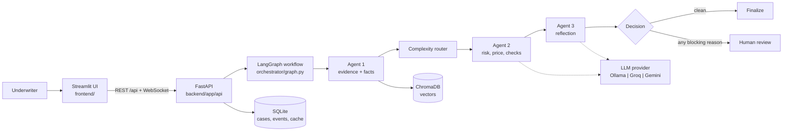
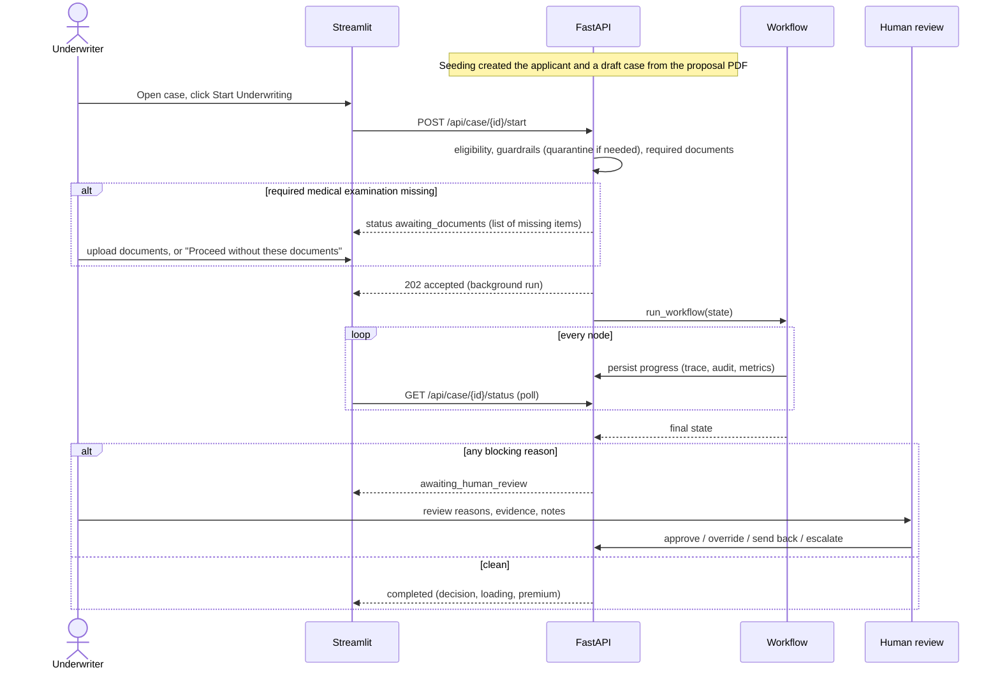
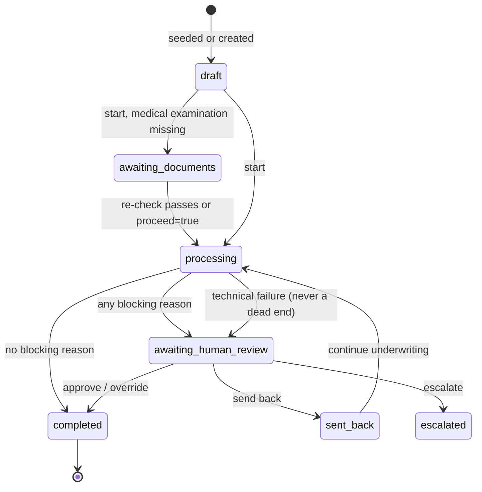
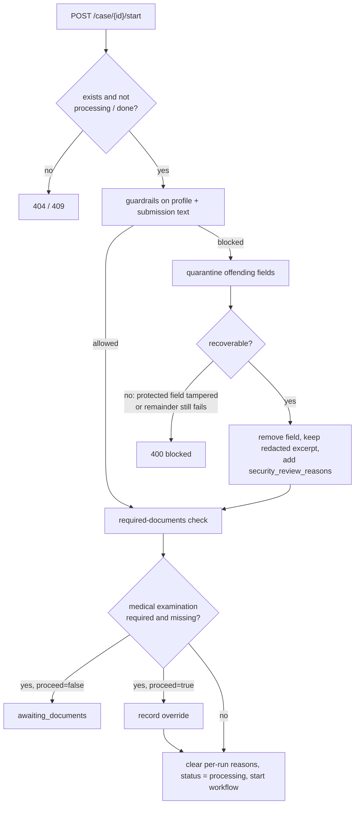
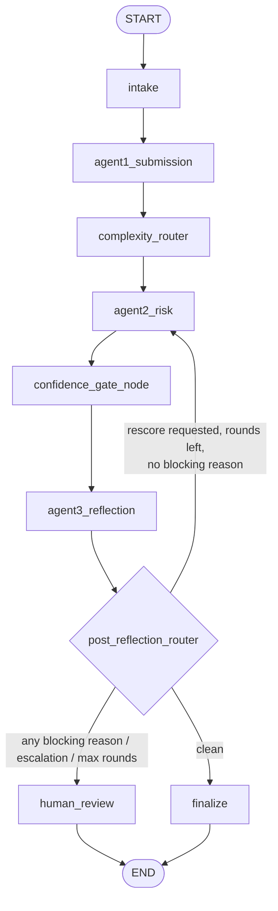
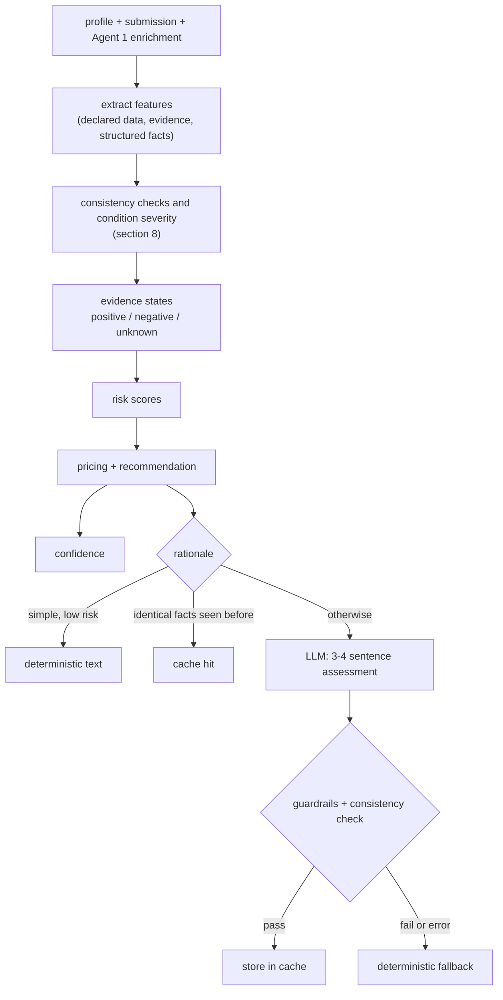
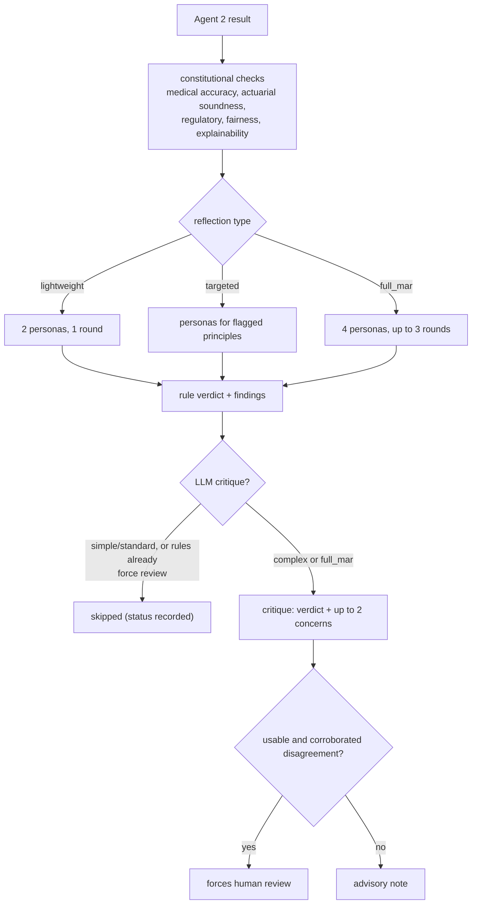

# MedUnderwrite AI: System Guide

| | |
|---|---|
| **Document** | System guide: how the platform works end to end |
| **Audience** | Underwriters, product owners, engineers, reviewers and auditors |
| **Scope** | Intake, document reading, the three-agent workflow, routing and decision rules, human review, caching, batch mode, security, APIs, configuration and operations |
| **Status** | Reflects the code in this repository. Pricing is a demonstration model and all data is synthetic. |

Companion documents: [`README.md`](../README.md) (quick start), [`diagram.md`](../diagram.md) (architecture diagrams), [`api-contract.md`](api-contract.md) (response shapes), and the developer notes in [`CLAUDE.md`](../CLAUDE.md) and [`backend/CLAUDE.md`](../backend/CLAUDE.md).

---

## Contents

1. [Purpose and design principles](#1-purpose-and-design-principles)
2. [Architecture at a glance](#2-architecture-at-a-glance)
3. [The life of a case](#3-the-life-of-a-case)
4. [Documents: reading, indexing and structured facts](#4-documents-reading-indexing-and-structured-facts)
5. [Before a run starts: eligibility, security and required documents](#5-before-a-run-starts-eligibility-security-and-required-documents)
6. [The workflow, node by node](#6-the-workflow-node-by-node)
7. [Decision rules reference](#7-decision-rules-reference)
8. [Evidence model and consistency checks](#8-evidence-model-and-consistency-checks)
9. [Human review](#9-human-review)
10. [Caching](#10-caching)
11. [Batch mode](#11-batch-mode)
12. [LLM usage, cost and performance](#12-llm-usage-cost-and-performance)
13. [Security and guardrails](#13-security-and-guardrails)
14. [Observability and audit](#14-observability-and-audit)
15. [Frontend guide](#15-frontend-guide)
16. [API reference](#16-api-reference)
17. [Configuration reference](#17-configuration-reference)
18. [Operations: setup, data and tests](#18-operations-setup-data-and-tests)
19. [Known limitations](#19-known-limitations)
20. [Glossary](#20-glossary)

---

## 1. Purpose and design principles

MedUnderwrite AI supports health-insurance underwriters. For each application it gathers evidence from the applicant's documents and a knowledge base, scores medical, claims and coverage risk, proposes a decision with a price, critiques that decision, and hands any case that needs judgment to a human.

The system is **decision support**, not an autonomous decision-maker. The design follows six principles.

| Principle | What it means in practice |
|---|---|
| **Decisions are computed in code** | Risk scores, loading, the recommendation and the routing to a human are deterministic and reproducible. The LLM never sets them. |
| **The LLM explains and challenges, it does not decide** | Agent 2 uses a model only to write a short assessment. Agent 3 may use one to critique, and a critique can only add caution. |
| **Unknown is not negative** | When evidence could not be found, the system records "unknown". It never turns silence into "no claims", "no coverage gap" or a protective factor. |
| **Discrepancies are not fraud** | The system reports *potential discrepancies* for a human to verify. Confirming fraud is a reviewer's decision. |
| **Mandatory review is sticky** | When a rule says a case must go to a human, no later step (reflection, finalization, a rescore) can clear it. |
| **Everything is traceable** | Each finding names its source document and rule; every node writes a trace and audit entry; each LLM call records its status, tokens and timing. |

---

## 2. Architecture at a glance



| Layer | Technology | Responsibility |
|---|---|---|
| UI | Streamlit (`frontend/app.py`, `components.py`, `api_client.py`) | Case list, workspace tabs, batch panel, review actions |
| API | FastAPI (`backend/app/api/routes.py`) | Cases, documents, start/batch, review actions, polling, WebSocket |
| Orchestration | LangGraph `StateGraph` over `UnderwritingState` | Node order, branching, rescore loop, checkpointing |
| Agents | Python modules under `app/agents/` | Evidence, scoring, consistency checks, reflection |
| Reading | `pypdf` layout mode (`app/rag/structured.py`) | Tables, sections and structured facts from PDFs |
| Retrieval | ChromaDB + `BAAI/bge-small-en-v1.5` embeddings | Applicant documents and knowledge collections |
| State | SQLite (`app/store/state_store.py`) | Applicants, cases, events, documents, pattern cache |
| LLM | Ollama (default), Groq or Gemini via `LLM_PROVIDER` | Short rationale and optional critique |
| Safety | `app/security/guardrails.py` + `config/guardrails.yml` | Input/output screening, quarantine, index-time scan |

---

## 3. The life of a case



Case statuses and the transitions between them:



A technical failure inside the workflow is converted into a human-review case with a plain-language reason; the underlying error stays in the case's `errors` list and event log.

---

## 4. Documents: reading, indexing and structured facts

### 4.1 Document set

Each applicant folder contains four kinds of PDF (`data/synthetic/applicants/APP-xxx/`):

| Folder | Examples | Contents |
|---|---|---|
| `underwriting/` | `UW-009_submission_request.pdf` | Proposal: case information, requested cover, declared conditions, medications and hospitalizations, existing insurance and claims, medical questionnaire, supporting-documents table, declaration |
| `medical/` | examination, specialist and discharge reports, MRI | Medical history, vitals, examination, **ICD-10 coded diagnoses**, medications, laboratory results |
| `claims/` | `CLM-00901_claim.pdf` | Claim record: event, diagnoses, financials, assessment |
| `policy/` | `POL-009_existing_policy.pdf` | Coverage, waiting periods, exclusions, the insurer's claims table |

### 4.2 Table-aware reading

Plain text extraction puts every table cell on its own line and loses which value belongs to which column. The reader (`app/rag/structured.py`) instead uses `pypdf`'s **layout mode**, which keeps columns aligned on one line, then:

1. removes repeating headers, footers and bullet glyphs;
2. splits the document into numbered sections (`1. Case Information`, ...);
3. classifies each block as **key-value**, **table** or **text**;
4. rebuilds table rows from the header's column offsets, merging wrapped cells (a row starts where its first column starts a capitalised cell; hospitalizations use their Duration column);
5. produces **section chunks** and **structured facts**.

If a document has no recognisable structure the system falls back to plain-text chunking and keyword checks, and marks `structured_facts.available = false`.

### 4.3 Chunking and indexing

- One chunk per section, split on row boundaries when long (default 800 characters).
- Table rows are rendered as `Header: value; Header: value`.
- Every chunk is prefixed with `[Document type, id | Section]` and carries `section`, `document_id` and a possible `security_flag` in its metadata.
- Re-indexing a document **replaces** its previous chunks, so a changed chunking never leaves stale chunks behind.
- At index time each chunk is scanned (regex only) for injected instructions and credentials.

### 4.4 Structured facts

| Source | Facts extracted |
|---|---|
| Proposal | Applicant name/DOB/age/ID, requested product and sum insured, declared conditions (with year and status), medications (dose, indication, duration), hospitalizations, existing insurance, declared claim IDs, questionnaire answers, supporting-document statuses, evidence-on-file list |
| Medical documents | Diagnoses with ICD-10 codes, vitals (BP, BMI, weight, height), smoking and alcohol, family history (kept separate), medications, **laboratory results** (value, unit, reference range, normal/high/low flag), relevant negative findings, document and applicant identity, age at the document date |
| Claim records | Claim ID, dates, reason, procedure, ICD diagnoses, billed/claimed/approved/settled amounts, status, coverage applicability |
| Policy schedule | Policy ID, holder and **insured member**, policy type (group or individual), inception and period, sum insured, waiting periods, pre-existing-disease period, exclusions, sub-limits, the insurer's claims table |

### 4.5 Identity verification of documents

Every non-proposal document is compared with the proposal's identity (applicant ID, date of birth, name). A document that does not match is **listed but excluded**: its diagnoses, labs, vitals and claims are held out of the analysis and it raises a discrepancy. A mismatched document is never silently associated with the applicant.

For policies the comparison is **role-aware**: on a group or employer policy the applicant is compared with the **insured member**, never the policyholder (the employer); on an individual policy the insured member, or the holder if no member is named. Missing identity fields are skipped safely.

---

## 5. Before a run starts: eligibility, security and required documents

These checks run in `routes.py::_prepare_case_for_run` for a single start and for every case in a batch.



**Security quarantine.** Text that contains injected instructions, credentials or forced-decision language is removed from the working copy instead of rejecting the whole case. A redacted excerpt is kept for audit and the case is routed to human review. Structured fields the decision depends on (age, conditions, medications, claims, product, sum insured) are protected: tampering there remains a hard block.

**Required documents.** A pre-policy medical examination is required when the age is 45 or more, the sum insured is 1,000,000 or more, or any condition is declared. If it is missing the case waits in **Awaiting documents**; the underwriter can upload it and re-check, or proceed without it (recorded as an override). Other gaps, such as items the proposal lists as "not submitted" or "partially submitted", are shown as outstanding documents; they never block and never lower confidence.

---

## 6. The workflow, node by node



State is the `UnderwritingState` TypedDict. A node can return only fields declared there; undeclared keys are dropped. Every node appends to `workflow_trace` and `audit_trail`, and no node raises: an exception is recorded and the case is handed to a human.

### 6.1 Intake
Validates the input and stamps the run. It contains no business logic.

### 6.2 Agent 1: Submission Intelligence
Agent 1 makes **no LLM call**. It runs its retrievals in parallel (worker threads):

| Task | Source |
|---|---|
| Applicant medical, claims, policy and proposal evidence | ChromaDB `applicant_documents`, filtered by applicant |
| Regulatory references and underwriting guidance | Knowledge collections, through the knowledge cache |
| Medical knowledge graph | Skipped when no condition is declared |
| **Structured facts** | The applicant's PDFs, table-aware (section 4) |

Then it:

1. runs a coverage-gap analysis that reuses the evidence already fetched;
2. **quarantines** any chunk flagged at index time (injected instructions, credentials), reporting it for human review;
3. computes **document requirements** (required, outstanding, blocking);
4. records metrics: latency, unique evidence chunks (each chunk counted once), cache events.

A per-case **retrieval budget** bounds the work: 12 vector queries, 25 chunks and 20 seconds, with 3 results per source.

### 6.3 Complexity router
A weighted score over explainable signals sets `simple`, `standard` or `complex`, which in turn decides whether Agent 2 may skip its LLM call and whether Agent 3 runs a critique.

| Signal | Points |
|---|---|
| Declared conditions | 1 each, up to 4 |
| High-risk keyword (e.g. myocardial infarction, stroke, cancer, renal failure, heart failure, transplant) | 3 each, up to 6 |
| Conflicting evidence | 2 |
| Prior claims | 2 for 4 or more, 1 for 2-3 |
| Hospitalizations | 2 for 3 or more, 1 for any |
| Current medications | 2 for 5 or more, 1 for 3-4 |
| Age | 2 for 65+, 1 for 50-64 |
| BMI 35 or above, or below 17 | 1 |
| Smoker | 1 |
| Sum insured of 2.5M or more with a medical history | 1 |

**Level:** `complex` if there is any high-risk keyword, conflicting evidence, three or more declared conditions, or a score of 4 or more (`router_complex_threshold`); `simple` if the score is 0; otherwise `standard`. The score breakdown is stored in the workflow trace.

### 6.4 Agent 2: Risk Assessment & Pricing
Agent 2 computes everything in code, then optionally asks the LLM for a short explanation.



**Risk scoring** (higher is riskier; all components capped at 100):

- *Medical:* age (60+: 20, 50-59: 12, 40-49: 6, 30-39: 5, under 30: 3); BMI (30+: 10, 25-29.9: 5); each declared condition by type (diabetes 15, hypertension 8, coronary/cardiac/heart 20, cancer 25, renal/kidney 18, liver 15, COPD 15, asthma 8, rheumatoid 10, arthritis 5, thyroid 4, other 3); a *controlled routine* condition counts half and a *serious* one adds 10; three or more conditions add 8; four or more medications add 5; hospitalizations add 5 each (up to 15); conditions found in documents but not declared add their weight (halved if routine, plus 10 if serious).
- *Claims:* 12 per claim (up to 45), plus 15 for three or more recent claims.
- *Coverage gap:* 10 per confirmed gap.
- **Overall = 0.60 x medical + 0.30 x claims + 0.10 x coverage**, never shown below 3 (no applicant is zero-risk).

**Protective factors** are added only from *confirmed* negatives (for example "no claims stated in the proposal or policy"); an unknown never creates one.

**Recommendation and pricing** are deterministic bands (see section 7.2). **Confidence** is described in section 7.3.

**Rationale.** The model writes only 3-4 sentences (at most 250 tokens) and may not change any number; a validator rejects output that contradicts the facts (for example asserting "no claims" when the claims state is unknown). The detailed breakdown shown in the UI (`reasoning_structured`) is built by code from the same values and can never disagree with them.

**Coverage notes** compare the declared and documented conditions and past claims with the existing policy: waiting periods satisfied or pending, claims only partly settled, and a note when the requested sum insured exceeds the existing cover.

### 6.5 Confidence gate
Sets the *depth* of reflection (high, medium, low) from confidence, risk and complexity. It does **not** skip reflection: Agent 3 always runs.

### 6.6 Agent 3: Reflection & Advisory



- **Reflection type:** `full_mar` if medical risk is 80+, overall risk 70+, a high-risk factor is present, two or more constitutional flags are raised, or confidence is below 0.70; `lightweight` if confidence is 0.85+ with no flags and risk below 60; otherwise `targeted`.
- **Personas** (medical expert, actuary, compliance officer, customer advocate) are rule-based reviewers. Evidence that was simply not retrieved is *unknown* and is not a concern; a regulatory reference that was not retrieved is "not assessed", not a compliance failure.
- **LLM critique** (JSON, at most 2 concerns, 450 tokens) is added only for complex or `full_mar` cases the rules do not already send to a human. A "disagree" blocks only when **corroborated**: a rule concern exists, a discrepancy needs review, the loading contradicts the risk band, or a claim inconsistency is confirmed in code. Otherwise it is an advisory note. The critique can only add caution and never lowers a score or changes a recommendation.
- **Rescore loop:** if the personas request it and no blocking reason exists, the case returns to Agent 2, up to 3 rounds. Metrics for repeated runs are summed (the Runs column shows how many).

### 6.7 Routing after reflection, human review and finalization
`post_reflection_router` evaluates the blocking reasons first; if there are any, the case goes to **human review** (the rescore loop is skipped). Otherwise it loops back for a rescore, or goes to **finalize**, which maps the recommendation to a decision:

| Recommendation | Decision | Final status |
|---|---|---|
| standard_acceptance | approved | completed |
| accept_with_loading | approved_with_loading | completed |
| accept_with_exclusion | approved_with_exclusion | completed |
| postpone | postponed | completed |
| decline | declined | completed |
| human_review, or any blocking reason | human_review_required | awaiting_human_review |

Finalization also stores the reviewer notes. Agent 2's own rule currently produces `standard_acceptance`, `accept_with_loading` or `human_review`.

---

## 7. Decision rules reference

### 7.1 What forces human review

Blocking reasons are computed in one place (`_business_review_reasons`) and read by the router, `finalize` and the end-of-run status check.

| Reason | Condition |
|---|---|
| High medical risk | Medical risk score 80 or more |
| High overall risk | Overall risk score 70 or more |
| Low confidence | Confidence below 0.70 |
| Discrepancy score | Score of 60 or more (`fraud_review_threshold`) |
| **Mandatory review** | A *serious* undeclared condition, or a document that is not this applicant's (date of birth or applicant ID mismatch) |
| **Verification required** | An undeclared condition that cannot be judged and whose missing information is material; undeclared smoking; a name mismatch on a document; several material evidence gaps at once |
| Security quarantine | Any input or document excluded by the guardrails |
| Reflection | A constitutional flag, a failed reflection, no consensus at the round limit, or a corroborated LLM disagreement |
| Technical failure | Any node error |

**Not** reasons to block (shown as reviewer notes): routine controlled undeclared conditions, claim-pattern notes, outstanding documents, policy notes (partly settled claims, sum-insured increase), unknown evidence that is not material, uncorroborated LLM concerns.

`mandatory_review_reasons` is written only by Agent 2, accumulates within a run, and is reset at the start of the next run. Agent 3 and finalization read it and cannot clear it.

### 7.2 Recommendation and pricing (demonstration model)

| Overall risk | Recommendation | Loading |
|---|---|---|
| below 30 | standard_acceptance (accept_with_loading if 3+ conditions) | 0% |
| 30-44.99 | accept_with_loading | 10% |
| 45-59.99 | accept_with_loading | 20% |
| 60-69.99 | accept_with_loading | 30% |
| 70 or more | human_review | 40% (indicative) |

`base premium = sum insured x 3% x term in years` (INR; 1,000,000 is used when no sum insured is stated); `final premium = base x (1 + loading)`. The pricing basis is labelled `DEMO_UNDERWRITING_MODEL` and is not actuarial pricing.

### 7.3 Confidence

Confidence measures how well the evidence supports the assessment. It starts at **0.60** and:

- adds **0.15** when medical evidence is positive;
- adds **0.08** for a clean declaration (no declared conditions and nothing found in the documents);
- adds **0.05** for each of claims, hospitalizations and policy whose state is *known* (positive or explicitly negative);
- subtracts **0.10** for confirmed coverage gaps and **0.05** when overall risk is 70 or more;
- subtracts **0.15** (up to 0.30) for each discrepancy that needs review, and up to **0.15** in proportion to the discrepancy score;
- subtracts **0.05** (up to 0.10) for each *material* unknown.

The result is capped at 0.95. An unknown area earns no credit but is not punished further unless it is material, so a sound case with a few non-material gaps is not pushed below the 0.70 line.

---

## 8. Evidence model and consistency checks

### 8.1 Evidence states

Five areas are tracked: **claims**, **hospitalizations**, **policy**, **medical**, and **regulatory** references.

| State | Meaning | Examples |
|---|---|---|
| **Positive** | Records exist | Claim records on file; hospital admissions declared; policy schedule present; medical documents present |
| **Negative** | An *explicit statement* says none | Policy states "Declared claims: None"; the questionnaire lists no admission; no existing policy declared |
| **Unknown** | Nothing retrieved and nothing stated | No claims evidence retrieved: this is **not** zero claims. A declared policy that was not retrieved: coverage was not assessed |

Consequences: protective factors and the confidence bonus use only confirmed negatives; the rationale cannot say "no claims" or "no coverage gap" from silence; evidence completeness counts only known areas; the rule-based reflection checks do not flag absent evidence. An unknown becomes a **verification item**, and is *material* when it bears on the decision: unknown claims with a high age or sum insured, a declared policy that is missing, or declared conditions with no medical document. Two or more material unknowns together trigger a verification review (`max_material_unknowns`).

### 8.2 Condition severity

Every condition, declared or documented, is assessed (`services/severity.py`) on severity, control, complications and evidence sufficiency.

| Tier | Meaning | Examples |
|---|---|---|
| **Serious** | High-impact condition or poor control | NSTEMI/MI, stent or angioplasty, established coronary disease, heart failure; cancer; stroke; HIV; CKD stage 3+ or eGFR below 60; hypertension with BP 160/100 or above or with complications; diabetes with HbA1c above 9 or a documented complication |
| **Moderate** | Present, not clearly controlled or severity not stated | Hypertension 140-159 / 90-99 or on three or more agents; diabetes with HbA1c 7.5-9 |
| **Routine** | Common and controlled | Hypertension below 140/90 with no complications; diabetes with HbA1c below 7.5; thyroid disorder; mild asthma |
| **Indeterminate** | Control cannot be judged | Hypertension with no BP reading; diabetes with no HbA1c |

Control is `controlled`, `fair`, `uncontrolled` or `unknown`. Reassuring results are recorded but never prove absence: for diabetes, normal fasting glucose, creatinine, eGFR and urine albumin-creatinine ratio are listed as reassuring, while HbA1c, diabetes duration and complication history are listed as missing. Family history is never counted as the applicant's condition. Overweight BMI alone never produces a finding.

### 8.3 How an undeclared condition is routed

| Tier of the undeclared condition | Result |
|---|---|
| Serious | **Mandatory human review**, even with a low overall score |
| Indeterminate with *material* missing information | Verification review |
| Indeterminate, missing information not material | Listed for the reviewer |
| Moderate or routine (strong groups) | Listed as "verify with the applicant"; no routing, the score decides |
| Weaker groups (e.g. digestive, spine) | A note |

Declared and documented conditions are compared **by group** (ICD-10 range first, wording second), so "kidney stones" matches "renal colic" and N20-N23, while chronic kidney disease (N18) is a different, material condition. A questionnaire "Yes" is matched by its own details text, not by the broad question.

### 8.4 Discrepancy findings

| Finding | Severity |
|---|---|
| Serious undeclared condition | Mandatory |
| Document date of birth or applicant ID differs from the proposal | Mandatory (document excluded) |
| Name differs, undeclared smoking | Verification |
| Declared age does not match the date of birth | Verify |
| Claim record differs from the insurer's schedule (amount or date), declared claim count differs, duplicate claims | Verify |

Patterns that are merely noteworthy (a number of claims, a large cover with a heavy history) are *notes* with no points. The discrepancy score is the sum of points and is capped at 100. `fraud_confirmed` is always false until a reviewer sets it.

---

## 9. Human review

A case in `awaiting_human_review` shows its **review reasons** (those that block) and **reviewer notes** (advisory), the scores, coverage and evidence, the discrepancy card, the security card, the evidence-state table and the condition assessment.

Actions (`/api/case/{id}/...`):

| Action | Effect |
|---|---|
| **approve** | Reviewer accepts the system's proposal; case completes |
| **override** | Reviewer records a different decision and a reason |
| **sendback** | Case returns to underwriting for more work (`sent_back`) |
| **escalate** | Case goes to senior review (`escalated`) |

Each action is stored with the reviewer, comments and time, and appears in the case history and audit trail.

---

## 10. Caching

| Cache | Key | Scope | Limits |
|---|---|---|---|
| **Rationale** | Hash of the exact facts, scores, pricing, recommendation and prompt version | Persistent (SQLite `pattern_cache`) plus in-process LRU of 256 | 7-day TTL, 2000 entries, invalidated by prompt version |
| **Knowledge** | Lookup kind + product + condition categories | Persistent plus in-process memo (1 hour) | Shared across similar cases |

- A rationale hit requires **identical** facts and scores; it is never fuzzy, so one applicant's numbers can never appear in another's text. Fraud-flagged cases are not stored.
- Each entry records the case that stored it. The case's **Cache** tab lists every hit, miss, store and skip for that run, with an *Open matched case* button.
- Changing the Agent 2 prompt requires bumping `prompt_version`.

---

## 11. Batch mode

1. **Suggest groups.** `POST /cases/batch/plan` groups draft cases by product, condition categories and age band, with the reason and what the group shares. Nothing runs yet.
2. **Approve and run.** The underwriter ticks groups; `POST /cases/batch` prepares each case (the same eligibility, security and document checks as a single start), skips ineligible ones with a reason, and runs the rest in the background. Groups of up to 8 run with a concurrency of 2.
3. **What is shared.** Only non-applicant knowledge (regulatory and guidance lookups, query embeddings). Scoring, rationale and review stay per case.
4. **What to expect.** A local model serves LLM calls largely one at a time, so batching raises throughput mainly with a hosted provider. Each case's page notes the batch and group it ran in; the list refreshes with real statuses when the batch ends.

---

## 12. LLM usage, cost and performance

| Where | Call | Cap | When it runs |
|---|---|---|---|
| Agent 1 | none | | never |
| Agent 2 | Short assessment | 250 tokens | Not for `simple` low-risk cases; not on an identical-facts cache hit |
| Agent 3 | Critique (JSON) | 450 tokens | Only complex / `full_mar` cases the rules do not already escalate |

Controls: explicit context window (`ollama_num_ctx`, default 4096), models kept loaded (`keep_alive` 30 minutes) and **preloaded at startup** for Ollama, JSON mode for the critique with a tolerant parser, and one model per role.

Per-call transparency is shown on the Workflow tab: LLM status (used, skipped, cache hit, rejected, failed with the reason), tokens in and out, latency, model load time, generation time and tokens per second. Estimated *data tokens* (what an agent read and produced) are shown separately from *LLM tokens* (what the model actually used). A failed call still records its real time and tokens.

Switching provider requires only `LLM_PROVIDER` and the keys and model names for that provider; the workflow is unchanged.

---

## 13. Security and guardrails

| Control | Behaviour |
|---|---|
| **Input screening** | Profile and submission text is checked for prompt injection, credentials, forced-decision language and personal identifiers (masked) before a run |
| **Quarantine** | Offending fields are removed, a redacted excerpt is audited, and the case requires human review; tampering with decision-critical structured fields is a hard block |
| **Index-time scan** | Document chunks with injected instructions or credentials are flagged and excluded from retrieval for that case |
| **Output validation** | The final decision and rationale text are screened; blocked output sends the case to a human |
| **LLM boundary** | Prompts contain structured facts, not raw document text; the LLM has no tools and cannot change a score |
| **Uploads** | Extension allow-list, size cap (`max_upload_mb`), sanitized file names |
| **Startup** | A warning if `SECRET_KEY` is still the development default outside development |

---

## 14. Observability and audit

| Record | Contents |
|---|---|
| `workflow_trace` | Each node with status, time and details (router score breakdown, counts) |
| `audit_trail` | Guardrail results, node actions, quarantine decisions |
| Workflow events | Persisted events (started, batch membership, awaiting documents, security quarantine, review actions) |
| `agent_metrics` / `workflow_metrics` | Latency, data and LLM tokens, LLM status, timing, cache events, unique-evidence statistics |
| Case tabs | Overview, Applicant, Submission, Evidence, Agents 1-3, Decision, Workflow, Cache, Human Review |

The UI polls `/api/case/{id}/status` (or the WebSocket) and shows the **running** stage, not the last completed one.

---

## 15. Frontend guide

| Area | Purpose |
|---|---|
| Dashboard | Counts and recent cases |
| All Cases | Search, filter by status (including Awaiting Documents), **Batch underwriting** panel |
| Applicants | Structured profile: conditions, medications, hospitalizations, claims, policy |
| Case workspace | Action bar (start, re-check documents, proceed without, human review) and the tabs listed above |
| Review queue | Cases waiting for a reviewer |
| System status | Backend and store health |

Key panels: **Potential discrepancies** (severity badges: must review, verify before relying, verify), **Evidence states and condition assessment**, **Reviewer notes**, **Security review**, **From the documents** (what the PDFs actually state), and the structured rationale (assessment plus breakdown by Medical, Claims, Coverage & Evidence, Scoring, Decision & Pricing).

---

## 16. API reference

All routes are under `/api`.

| Area | Method and path |
|---|---|
| Applicants | `GET/POST /applicants`, `GET /applicants/{id}` |
| Cases | `GET/POST /cases`, `GET /case/{id}`, `GET /case/{id}/status`, `GET /case/{id}/events`, `GET /case/{id}/cache` |
| Run | `POST /case/{id}/start` (`?proceed=true` to run without a missing medical examination), `POST /underwrite`, `WS /ws/status/{case_id}` |
| Batch | `POST /cases/batch/plan`, `POST /cases/batch` |
| Documents | `GET/POST /case/{id}/documents`, `DELETE /case/{id}/documents/{document_id}` |
| Review | `GET /case/{id}/reviews`, `POST /case/{id}/approve`, `/override`, `/sendback`, `/escalate` |
| Health | `GET /health` (outside `/api`) |

Start returns `202` with the case moving to `processing`, or `200` with `status: awaiting_documents` and the missing items. Responses use `{ "success", "data", "error" }`.

---

## 17. Configuration reference

Settings come from `.env` (see `.env.example`) through `app/config.py`.

| Setting | Default | Effect |
|---|---|---|
| `LLM_PROVIDER` | `ollama` | `ollama`, `groq` or `gemini` |
| `REASONING_MODEL` / `REFLECTION_MODEL` | `gemma3:4b` | Models per role |
| `ollama_num_ctx`, `ollama_keep_alive` | 4096, 30m | Context window and residency |
| `reasoning_max_tokens`, `reflection_max_tokens` | 250, 450 | LLM output caps |
| `skip_llm_for_simple_cases`, `skip_llm_risk_ceiling` | true, 40 | Deterministic rationale for simple low-risk cases |
| `reflection_llm_enabled` | true | LLM critique on or off |
| `router_complex_threshold` | 4 | Complexity score for `complex` |
| `fraud_review_threshold` | 60 | Discrepancy score that forces review |
| `max_material_unknowns` | 2 | Material unknowns that trigger verification review |
| `doc_medical_age_threshold`, `doc_medical_sum_insured_threshold` | 45, 1,000,000 | When a medical examination is required |
| `max_upload_mb` | 20 | Upload size cap |
| `batch_max_group_size`, `batch_concurrency` | 8, 2 | Batch grouping and parallelism |
| `rag_max_calls_per_case`, `rag_max_chunks_per_case`, `rag_max_seconds_per_case` | 12, 25, 20 | Retrieval budget |
| `pattern_cache_ttl_sec`, `pattern_cache_max_entries` | 7 days, 2000 | Persistent cache |
| `prompt_version` | v4 | Bump when the Agent 2 prompt changes |
| `warm_llm_on_startup` | true | Preload Ollama models |

The medical-risk (80), overall-risk (70) and confidence (0.70) review thresholds and `MAX_REFLECTION_ROUNDS` (3) are constants in `orchestrator/graph.py` (mirrored, unused, in settings); change both together.

---

## 18. Operations: setup, data and tests

```bash
cp .env.example .env                    # choose provider and models
cd backend && pip install -r requirements.txt
python -m app.services.seed_database    # read proposals into applicants and draft cases
python -m app.services.index_data       # index documents into ChromaDB
uvicorn app.main:app --reload --port 8000
cd ../frontend && pip install -r requirements.txt && streamlit run app.py
```

- With Ollama, pull the models named in `.env` first.
- After upgrading the document reader, re-run `seed_database` and `index_data`.
- Optional scenario applicants (`APP-011` to `APP-015`: cache twins, discrepancies, security, required documents): `python -m scripts.create_scenario_data`, then seed and index again.

**Tests** (run from `backend/`):

- `tests/test_structured.py` reads the real 15-PDF bundle in `docs/APP-009.zip` and needs only `pypdf`.
- `tests/test_decision_routing.py` covers severity, evidence states, role-aware identity, lab parsing and sticky mandatory review; it also runs against `docs/APP-001.zip` and `docs/APP-002.zip` when those bundles are present.
- The remaining tests (`test_agent*.py`, `test_flow.py`, `test_hitl.py`, `test_rag.py`) exercise the real agents and need a reachable LLM and an indexed store.

---

## 19. Known limitations

- **No authentication or role checks** on the API; reviewer identity is supplied by the caller.
- **Pricing is a demonstration model**, not actuarial pricing.
- **Layout assumptions:** table reading is tuned to the document templates in the sample data; documents with a different layout fall back to text-based behaviour.
- **Local model throughput:** LLM calls are largely serialized by a local server, so batch mode and critiques cost wall-clock time until a hosted provider is used.
- **Infrastructure scaffolds:** the Docker Compose frontend build, CI tests and deployment files are incomplete.
- **Evidence-state limits:** a "negative" depends on explicit statements in the proposal or policy; where documents are silent the state stays unknown.
- **Condition severity** uses a documented rule set and ICD ranges; it covers common conditions and is meant to be extended with underwriting guidelines.

---

## 20. Glossary

| Term | Meaning |
|---|---|
| **Awaiting documents** | A case paused because a required document, the pre-policy medical examination, is missing |
| **Blocking reason** | A rule outcome that sends a case to human review |
| **Corroborated** | An LLM objection backed by a rule concern or a check confirmed in code |
| **Discrepancy** | A potential mismatch between the proposal and the documents, or between documents; not confirmed fraud |
| **Evidence state** | Positive, negative or unknown knowledge about an area |
| **Insured member** | The person covered by a policy; on group policies, distinct from the employer policyholder |
| **MAR** | Multi-agent reflection: the four persona reviewers in Agent 3 |
| **Mandatory review** | A blocking reason set by Agent 2 that nothing later can clear |
| **Quarantine** | Excluding a flagged input or document chunk from analysis while the case continues for human review |
| **Reviewer note** | An advisory item shown to the reviewer that never blocks |
| **Structured facts** | Diagnoses, vitals, labs, claim records and policy terms read from the PDFs |
| **Tier** | Severity class of a condition: serious, moderate, routine or indeterminate |
